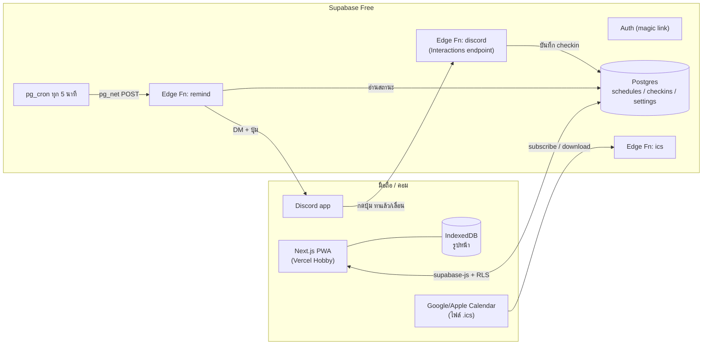

# SkinDaily: ระบบออกแบบเว็บแอพสกินแคร์ส่วนตัว (ฉบับเต็ม)

> เว็บแอพ PWA สำหรับใช้คนเดียว อัพโหลดตารางสกินแคร์ 30 วันจาก Excel แล้วระบบจะบอกว่าแต่ละวันต้องทาอะไร ทาตามลำดับไหน ทั้งตอนเช้าและก่อนนอน ตารางวนซ้ำทุก 30 วัน และอัพโหลดตารางใหม่มาแทนได้ทุกเมื่อ แจ้งเตือนผ่าน Discord ซ้ำจนกว่าจะติ๊กว่าทาแล้ว มีระบบถ่ายรูปติดตามผิว
>
> **ข้อกำหนดตายตัว:** ไม่เสียเงินเลย · ไม่ใช้ AI (ทุกกฎเป็น if/else) · ไม่ต้องพึ่งเพื่อน · ลืมให้ได้ยากที่สุด

---

## 0. สารบัญ

1. [เป้าหมายและหลักการออกแบบ](#1-เป้าหมายและหลักการออกแบบ)
2. [สถาปัตยกรรมและ Tech Stack](#2-สถาปัตยกรรมและ-tech-stack)
3. [การอ่านไฟล์ Excel](#3-การอ่านไฟล์-excel)
4. [โมเดลข้อมูลตาราง (Schedule JSON)](#4-โมเดลข้อมูลตาราง-schedule-json)
5. [ลอจิกหลัก](#5-ลอจิกหลัก)
6. [ระบบแจ้งเตือน (กันลืม 4 ชั้น)](#6-ระบบแจ้งเตือน-กันลืม-4-ชั้น)
7. [Discord](#7-discord)
8. [หน้าจอทั้งหมด](#8-หน้าจอทั้งหมด)
9. [ระบบรูปติดตามผิว](#9-ระบบรูปติดตามผิว)
10. [ฐานข้อมูล (Supabase)](#10-ฐานข้อมูล-supabase)
11. [Edge Functions](#11-edge-functions)
12. [PWA และข้อจำกัดของแต่ละแพลตฟอร์ม](#12-pwa-และข้อจำกัดของแต่ละแพลตฟอร์ม)
13. [ความปลอดภัยและความเป็นส่วนตัว](#13-ความปลอดภัยและความเป็นส่วนตัว)
14. [โครงสร้างโปรเจกต์](#14-โครงสร้างโปรเจกต์)
15. [ขั้นตอนติดตั้งและ Deploy](#15-ขั้นตอนติดตั้งและ-deploy)
16. [แผนพัฒนาและเกณฑ์ทดสอบ](#16-แผนพัฒนาและเกณฑ์ทดสอบ)
17. [ข้อสังเกตจากตารางจริง](#17-ข้อสังเกตจากตารางจริง)
- [ภาคผนวก A: `core.js` (ทดสอบแล้ว)](#ภาคผนวก-a-libcorejs)
- [ภาคผนวก B: `xlsx.js` (ทดสอบแล้ว)](#ภาคผนวก-b-libxlsxjs)

---

## 1. เป้าหมายและหลักการออกแบบ

### ปัญหา
ผู้ใช้ไม่ค่อยทาสกินแคร์และลืมบ่อย อีกทั้งตารางสลับไปมาระหว่าง 3 แบบ (A แต้มสิว / B มาสก์ / C พักผิว) ทำให้จำเองไม่ได้ว่าคืนนี้ต้องใช้ตัวไหน และถ้าใช้ผิดคู่ (เช่น CeraVe SA คู่กับ Retinol) ผิวอาจแสบหรือลอก

### หลักการ
| หลักการ | ความหมายในระบบ |
|---|---|
| **ไม่ต้องคิด** | เปิดแอพแล้วเห็นแค่ "ตอนนี้ต้องทาอะไร" ทำทีละขั้น |
| **ลืมไม่ได้** | แจ้งเตือนหลายช่องทาง เตือนซ้ำจนกว่าจะติ๊ก ถ้าช่องทางไหนพลาดยังมีช่องทางอื่น |
| **ยึดปฏิทิน ไม่ยึดการกด** | ลืมไป 1 วัน ตารางไม่เลื่อน คืน Retinol จึงไม่มาติดกัน |
| **ปลอดภัยด้วยกฎ** | ตรวจตารางตามกฎจากชีต Tips ของผู้ใช้เอง ไม่ใช้ AI |
| **ฟรี 100%** | Supabase Free + Vercel Hobby + Discord |
| **รูปหน้าไม่ขึ้นคลาวด์** | เก็บใน IndexedDB บนเครื่อง และ export สำรองได้ |

### สิ่งที่ไม่ทำ (Non-goals)
- ไม่วิเคราะห์ผิวด้วย AI และไม่แนะนำผลิตภัณฑ์
- ไม่รองรับหลายผู้ใช้ (แต่ schema มี `user_id` ไว้แล้ว ขยายภายหลังได้)
- ไม่ทำแอพ native (ผู้ใช้ไม่มี Mac สำหรับ build iOS จึงใช้ PWA)

---

## 2. สถาปัตยกรรมและ Tech Stack



| ชั้น | เลือกใช้ | เหตุผล / ค่าใช้จ่าย |
|---|---|---|
| Frontend | **Next.js 15 (App Router) + TypeScript + Tailwind** แบบ static export ได้ | stack ที่ถนัด; Vercel Hobby ฟรี |
| อ่าน Excel | `lib/xlsx.js` (ภาคผนวก B, ไม่มี dependency) หรือ SheetJS | อ่านในเบราว์เซอร์ ไฟล์ไม่ต้องขึ้นเซิร์ฟเวอร์ |
| ลอจิกกลาง | `lib/core.js` (ภาคผนวก A) ใช้ไฟล์เดียวกันทั้งเว็บและ Edge Function | กฎเหมือนกันทุกที่ ทดสอบได้ใน Node |
| DB + Auth | Supabase Free (Postgres 500MB, Auth) | ฟรี |
| ตัวตั้งเวลา | `pg_cron` + `pg_net` ใน Supabase | ฟรี ทำงานทุก 5 นาที (Vercel Hobby cron รันได้แค่วันละครั้ง จึงไม่ใช้) |
| แจ้งเตือน | Discord Bot (DM + ปุ่ม) หรือ Webhook | ฟรี |
| สำรองแจ้งเตือน | ไฟล์ `.ics` | ทำงานได้แม้เซิร์ฟเวอร์ล่ม |
| รูป | IndexedDB (ผ่าน `idb-keyval` หรือเขียนเอง) | ฟรี เป็นส่วนตัว |

---

## 3. การอ่านไฟล์ Excel

### 3.1 รูปแบบไฟล์ที่รองรับ (ตามไฟล์จริงของผู้ใช้)

**ชีตที่ 1: ตารางรายวัน** (จำเป็น)

| ลำดับวัน | วันที่ | ขั้นตอนตอนเช้า (Morning) | ขั้นตอนตอนเย็น (Night Routine) | รูปแบบคืนนี้ | หมายเหตุ… |
|---|---|---|---|---|---|
| วัน 1 | 10/11/2026 | `CeraVe SA Cleanser -> AMT Liposome -> …` | `CeraVe SA Cleanser -> …` | `[C] คืนพักผิว` | ใช้ CeraVe SA… |

**ชีตที่ 2: Routines** (ไม่บังคับ) มีตารางสินค้า (ลำดับ / ประเภท / ชื่อสินค้า / วิธีใช้) และตาราง "รูปแบบคืน" `[A] [B] [C]`

**ชีตที่ 3: Tips** (ไม่บังคับ) หัวข้อ / คำแนะนำ / เหตุผล

### 3.2 กฎการอ่าน (ไม่ผูกกับชื่อชีตหรือตำแหน่งคอลัมน์)

1. **หาตารางรายวัน:** ไล่ทุกชีต หาแถวแรกที่มีทั้งเซลล์ที่ match `/เช้า|morning/i` และเซลล์ที่ match `/เย็น|night|ก่อนนอน|evening/i` แถวนั้นคือหัวตาราง
2. **แมปคอลัมน์จากหัวตาราง:**
   - `am` = คอลัมน์ที่ match `/เช้า|morning/i`
   - `pm` = คอลัมน์ที่ match `/เย็น|night|ก่อนนอน|evening/i` (ไม่ใช่คอลัมน์ am)
   - `day` = `/ลำดับ|^day\b/i` ถ้าไม่เจอใช้คอลัมน์แรก (**ห้าม** match แค่คำว่า "วัน" เพราะจะไปชนคอลัมน์ "วันที่")
   - `type` = `/รูปแบบ|type|ประเภท/i`, `note` = `/หมายเหตุ|note/i`
3. **ไม่ใช้คอลัมน์ "วันที่" ในการคำนวณ** ใช้ลำดับแถวแทน วันจริงคำนวณจาก `start_date` ที่ผู้ใช้เลือกตอนอัพโหลด (ดู 5.2)
4. **แยกขั้นตอน:** split ด้วย `/\s*(?:->|→|➔|➜|=>|\n)\s*/` แล้ว trim และตัดช่องว่างทิ้ง
5. **รูปแบบคืน:** `/\[\s*([A-Za-z0-9ก-ฮ]+)\s*\]\s*(.*)/` แยกได้ `type = "B"` และ `typeLabel = "คืนมาสก์หน้า"`
6. **ตารางสินค้า:** หาแถวหัวที่มี `/ชื่อสินค้า|^product/i` แล้วอ่านแถวถัดไปที่คอลัมน์แรกเป็นตัวเลขทั้งหมด
7. **ตารางรูปแบบคืน:** หาแถวหัว `/รูปแบบคืน/` แล้วอ่านแถวที่ขึ้นต้นด้วย `[X]` เซลล์อย่าง `SKINTIFIC Retinol Daily Mask (10-15 นาที)` แยกเป็นชื่อสินค้ากับวิธีใช้ (ข้อความในวงเล็บ) และเพิ่มเข้า products
8. **Tips:** หาแถวหัว `หัวข้อ` แล้วเก็บ `{topic, advice, reason}`
9. **ไฟล์ xlsx มี 2 แบบที่ต้องรองรับ:** เซลล์แบบ `inlineStr` (ไฟล์ของผู้ใช้ซึ่งสร้างจาก openpyxl) และ `sharedStrings` (ไฟล์ที่เซฟจาก Excel/Google Sheets) และต้องถอด entity `&#3605;` เป็นภาษาไทยได้

### 3.3 จับคู่ชื่อย่อในตารางกับสินค้า (Fuzzy match แบบไม่ใช้ AI)

ในตารางรายวันใช้ชื่อย่อ เช่น `SKINTIFIC Spray` ส่วนในชีต Routines ใช้ชื่อเต็ม `SKINTIFIC Radiance Booster Serum Spray` จับคู่แบบนี้:

- ตัดคำด้วย regex `/[^\p{L}\p{M}\p{N}]+/u`
  > ⚠️ **ต้องมี `\p{M}`** ไม่อย่างนั้นสระบน/ล่างและวรรณยุกต์ไทย (เช่น ั ่ ้) จะถูกนับเป็นตัวคั่น ทำให้ "กันแดด" ถูกหั่นเป็นชิ้น และจับคู่ "กันแดด Mist" ไม่ได้ (ทดสอบเจอบั๊กนี้จริงและแก้แล้ว)
- แปลงคำพ้องด้วยตาราง alias: `กันแดด→sunscreen`, `คลีนเซอร์→cleanser`, `เซรั่ม→serum`, `มาสก์→mask`, `สเปรย์→spray`
- คะแนน = จำนวนคำของชื่อขั้นที่พบในชื่อสินค้า ถ้าชื่อขั้นมีหลายคำต้องได้ ≥ 2 คะแนน ถ้ามีคำเดียวต้องได้ ≥ 1
- ถ้าคะแนนเท่ากัน เลือกตัวที่มีวิธีใช้ (howto)

**ผลทดสอบกับไฟล์จริง:**

| ชื่อในตาราง | จับคู่ได้ | วิธีใช้ / ตัวจับเวลา |
|---|---|---|
| CeraVe SA Cleanser | CeraVe SA Smoothing Cleanser | ล้างหน้าคุมมัน… |
| AMT Liposome | AMT Liposome Serum | กด 1-2 ปั๊ม… |
| SKINTIFIC Spray | SKINTIFIC Radiance Booster Serum Spray | เขย่าขวด 3-5 ครั้ง… |
| กันแดด Mist | SKINTIFIC Sunscreen Mist SPF50+ | รอ 15–30 นาทีก่อนออกแดด (`before`) |
| SKINTIFIC Retinol Mask | SKINTIFIC Retinol Daily Mask | ⏱ 10–15 นาที (`hold`) |
| Provamed Retinol Gel | Provamed Retinol-A Gel | แต้มบางๆ เฉพาะสิว |
| SKINTIFIC Rose Cleanser | SKINTIFIC Rose Cleanser | อ่อนโยน |

### 3.4 ตัวจับเวลาที่อ่านได้จากข้อความ
- regex: `/(\d+)\s*(?:-|–|ถึง)?\s*(\d+)?\s*(?:นาที|min)/i`
- ถ้าข้อความมีคำว่า `ก่อน|before` ให้เป็น `kind: "before"` (เช่น กันแดดก่อนออกแดด) ซึ่งแสดงเป็นคำเตือนพร้อมตัวจับเวลาที่เลือกเปิดได้
- ถ้าไม่มี ให้เป็น `kind: "hold"` (เช่น มาสก์ 10-15 นาที) ซึ่งต้องนับเวลาให้ครบก่อนไปขั้นถัดไป (กดข้ามได้)

---

## 4. โมเดลข้อมูลตาราง (Schedule JSON)

ผลลัพธ์จาก `buildSchedule(sheets)` เก็บลงคอลัมน์ `schedules.data` (jsonb)

```jsonc
{
  "v": 1,
  "title": "ตารางดูแลผิว 30 วัน (… แก้ไขตารางรวม B)",
  "subtitle": "สำหรับผิวมัน เป็นสิว และผิวแพ้ง่าย …",
  "days": [
    {
      "n": 4,
      "label": "วัน 4",
      "am": ["CeraVe SA Cleanser", "AMT Liposome", "SKINTIFIC Spray", "AMT Light Emulsion", "กันแดด Mist"],
      "pm": ["SKINTIFIC Rose Cleanser", "AMT Liposome", "SKINTIFIC Retinol Mask", "AMT Light Emulsion"],
      "type": "B",
      "typeLabel": "คืนมาสก์หน้า",
      "note": "ใช้ SKINTIFIC Rose Cleanser (อ่อนโยน) + SKINTIFIC Retinol Mask 10-15 นาที"
    }
    // … ทั้งหมด 30 วัน
  ],
  "products": [
    { "name": "CeraVe SA Smoothing Cleanser", "category": "Cleanser", "howto": "ล้างหน้าคุมมัน…", "slot": "am" }
  ],
  "nightTypes": {
    "A": { "label": "คืนแต้มสิวอุดตัน", "cells": ["…"] },
    "B": { "label": "คืนมาสก์หน้า", "cells": ["…"] },
    "C": { "label": "คืนพักผิว (Rest Day)", "cells": ["…"] }
  },
  "tips": [{ "topic": "1. หลักการสลับ Cleanser", "advice": "…", "reason": "…" }]
}
```

ระบบจะคำนวณขั้นตอนที่ใช้แสดงผลจริง (`routineFor()`) ทุกครั้งที่ต้องใช้ ไม่เก็บลง DB จึงปรับกฎการจับคู่ทีหลังได้โดยไม่ต้องอัพโหลดใหม่

```ts
type Step = {
  i: number;
  name: string;          // ชื่อในตาราง
  product: string;       // ชื่อเต็มที่จับคู่ได้
  category: string;
  howto: string;
  timer: { min: number; max: number; kind: "hold" | "before" } | null;
  flags: { retinol: boolean; bha: boolean; aha: boolean; sunscreen: boolean; cleanser: boolean };
  swapped: boolean;      // ถูกสลับเพราะโหมดผิวแสบ
};
```

---

## 5. ลอจิกหลัก

### 5.1 "วัน" ของระบบ (Logical day)
- เขตเวลาเริ่มต้นคือ `Asia/Bangkok` และวันเปลี่ยนตอน **04:00** (`dayBoundaryHour`) ไม่ใช่เที่ยงคืน
- เหตุผล: ถ้าทาสกินแคร์ก่อนนอนตอนตี 1 ควรนับเป็นของ "คืนเมื่อวาน" ไม่ใช่ของวันใหม่
- `logicalDate(now) = วันที่ของ (now − 4 ชม.) ในเขตเวลา Asia/Bangkok`

### 5.2 วนรอบ 30 วัน
```
cycleDay(start_date, date, L) = ((diffDays(date, start_date) mod L) + L) mod L + 1
```
- `L` = จำนวนวันในตาราง (ปกติ 30 แต่รองรับจำนวนอื่นด้วย)
- ยึดตามปฏิทินเสมอ ถ้าลืมไป 1 วัน วันถัดไปก็ยังเป็นวันถัดไปตามตาราง ลำดับ A-C-B-C จึงไม่เพี้ยน
- ทดสอบแล้ว: เริ่ม 10/11/2026 → วันที่ 10/12/2026 = วัน 1 ของรอบใหม่ ✔

### 5.3 หลายเวอร์ชันของตาราง
- ทุกครั้งที่อัพโหลดจะได้ schedule แถวใหม่ (ไม่ทับของเดิม) และต้องเลือก `start_date` ด้วย
  - **"เริ่มพรุ่งนี้"** (ค่าเริ่มต้น) วันนี้ยังใช้ตารางเดิม
  - **"เริ่มวันนี้"**
  - **"ต่อจากวันเดิมในรอบ"** คำนวณ `start_date` ให้วันที่ในรอบยังเป็นเลขเดิม เช่น วันนี้วัน 12 ตารางใหม่ก็เริ่มที่วัน 12
- `scheduleFor(date)` = schedule ที่ `enabled` และมี `start_date ≤ date` มากที่สุด (ถ้าเท่ากันเลือกตัวที่สร้างทีหลัง)
- ผลคือประวัติย้อนหลังในปฏิทินยังแสดงตารางที่ใช้จริงในวันนั้น และตั้งตารางล่วงหน้าได้

### 5.4 โหมด "วันนี้ผิวแสบ/ตึง" (จาก Tips ข้อ 4)
- กดปุ่มแล้วตั้ง `settings.sensitiveUntil = วันนี้ + N วัน` (เลือก 1/3/7 วัน)
- ระหว่างนั้นขั้นที่เป็นคลีนเซอร์และมีกรด (`bha`/`aha`) จะถูกสลับเป็นคลีนเซอร์อ่อนโยนตัวแรกที่เจอในตาราง (ในตารางนี้คือ SKINTIFIC Rose Cleanser) ทั้งเช้าและเย็น
- ขั้นที่ถูกสลับมีป้าย "🔄 สลับเพราะผิวแสบ"
- ทดสอบแล้ว: วัน 2 ตอนเช้า `CeraVe SA Cleanser` → `SKINTIFIC Rose Cleanser` ✔

### 5.5 ตรวจตารางตอนอัพโหลด (กฎจากชีต Tips ไม่ใช้ AI)

| ระดับ | กฎ | ที่มา |
|---|---|---|
| 🔴 error | ในรอบเดียวกันมีกรด (SA/BHA/AHA) คู่กับ Retinol | Tips ข้อ 1 |
| 🔴 error | ในรอบเดียวกันมี Retinol มากกว่า 1 ตัว (Gel + Mask) | Tips ข้อ 3 |
| 🔴 error | วันไหนไม่มีขั้นตอนเลย | — |
| 🟠 warn | ตอนเช้ามี Retinol | หลักทั่วไป |
| 🟠 warn | ตอนเช้าไม่มีกันแดด | Tips ข้อ 5 |
| 🟠 warn | Retinol 2 คืนติดกัน (ตรวจรอยต่อวัน 30 → วัน 1 ด้วย) | ผิวแพ้ง่าย |
| 🔵 info | มีรูปแบบคืนในชีต Routines ที่ไม่ได้ใช้ในตารางเลย | ดูข้อ 17 |
| 🔵 info | ตารางไม่ใช่ 30 วัน | — |

- ถ้ามี error ต้องติ๊ก "เข้าใจความเสี่ยงแล้ว" ก่อนถึงจะบันทึกตารางได้
- ผลทดสอบ: ทั้งไฟล์เดิมและไฟล์ B ผ่านทุกกฎ (ไม่มี error/warn)

**Regex ที่ใช้ระบุส่วนผสม:**
```js
retinol:   /retinol|retinal|เรตินอล|tretinoin|adapalene|retinoid/i
bha:       /\bSA\b|salicylic|\bBHA\b|ซาลิไซลิก/i
aha:       /\bAHA\b|glycolic|lactic|mandelic/i
sunscreen: /sunscreen|กันแดด|\bSPF\b|sunblock/i
cleanser:  /cleanser|คลีนเซอร์|โฟม|ล้างหน้า|cleansing/i
```

### 5.6 Streak + บัตรผ่าน (Freeze)
- วันที่นับเป็น "ผ่าน" ต้องติ๊กครบทั้ง `am` และ `pm`
- วันนี้ยังไม่จบ จึงไม่ทำให้ streak หาย
- **Freeze:** พลาดได้ `freezesPerWeek` วันต่อสัปดาห์ (ค่าเริ่มต้น 1, สัปดาห์เริ่มวันจันทร์) วันที่ใช้ freeze ไม่ทำให้ streak หายแต่ก็ไม่บวกเพิ่ม ใช้ได้เมื่อ streak > 0 เท่านั้น
- สถานะรายวัน: `done` · `frozen` · `half` (ทาแค่รอบเดียว) · `missed` · `today` · `half-today` · `future`
- ทดสอบแล้ว: ทำครบ 10, ขาดคืน 11, ครบ 12–13 → วัน 11 = `frozen`, streak = 3 ✔

### 5.7 สถิติ
- `periodStats(from, to)` → อัตราทาครบ %, จำนวนรอบเช้า/เย็น, **รอบที่ลืมบ่อยที่สุด** เช่น "ตอนเช้าวันเสาร์ (3 ครั้ง)"
- แสดงในหน้า Calendar และส่งใน Discord ทุกวันอาทิตย์

---

## 6. ระบบแจ้งเตือน (กันลืม 4 ชั้น)

| ชั้น | ช่องทาง | ทำงานเมื่อ | จุดอ่อน |
|---|---|---|---|
| 1 | **Discord DM + ปุ่ม** (หลัก) | ถึงเวลาและยังไม่ติ๊ก ส่งซ้ำทุก 15 นาที | ถ้าเปิด Discord บนคอมทิ้งไว้ มือถืออาจไม่เด้ง |
| 2 | **ปฏิทิน .ics** (สำรอง) | ทุกวันตามเวลาที่ตั้ง เตือน 2 ครั้ง (ตรงเวลา และ +20 นาที) | ไม่รู้ว่าติ๊กแล้วหรือยัง |
| 3 | **NFC/QR ที่กระจกห้องน้ำ** | สแกนแล้วเปิดหน้า Focus ของรอบนั้นทันที | ต้องเดินไปที่กระจกเอง |
| 4 | **หน้าแอพ** | badge แดง และแบนเนอร์ "ยังไม่ทา" เด่นที่สุดในหน้า | ต้องเปิดแอพก่อน |

### 6.1 ช่วงเวลาที่จะเตือน (ค่าเริ่มต้น แก้ได้ใน Settings)

| รอบ | เริ่มเตือน | หยุดเตือน |
|---|---|---|
| เช้า | `amTime` 07:30 | `amCutoff` 13:00 |
| ก่อนนอน (คืนปกติ) | `pmTime` 21:30 | 04:00 ของวันถัดไป |
| ก่อนนอน (คืนที่มีขั้นจับเวลา เช่น มาสก์ [B]) | `pmTime − 20 นาที` = 21:10 | 04:00 |

- ระบบหาคืนที่มีขั้นจับเวลาเองจาก `timer.kind === "hold"` ไม่ได้ hardcode ว่าเป็นคืน B
- เตือนซ้ำทุก `repeatMin` (15 นาที) สูงสุด `maxRepeats` (8) ครั้งต่อรอบ

### 6.2 ข้อความแบบแรงขึ้นเรื่อย ๆ
| ครั้งที่ | เช้า | ก่อนนอน |
|---|---|---|
| 1 | ☀️ อรุณสวัสดิ์! ได้เวลาสกินแคร์ตอนเช้าแล้ว | 🌙 ได้เวลาสกินแคร์ก่อนนอนแล้ว |
| 2 | ☀️ ยังไม่ได้ติ๊กตอนเช้านะ — อย่าลืมกันแดด | 🌙 ยังไม่ได้ติ๊กก่อนนอนนะ |
| 3 | ⏰ ผ่านมา {mins} นาทีแล้ว ยังไม่ได้ทาตอนเช้า | ⏰ ผ่านมา {mins} นาทีแล้ว — ล้างหน้าก่อนเผลอหลับ |
| 4 | 🚨 แดดแรงขึ้นทุกนาที! ทากันแดดเดี๋ยวนี้ | 🚨 อย่าเพิ่งนอน! ยังไม่ได้ทาสกินแคร์ |
| 5+ | 🔥 streak {streak} วันกำลังจะหาย — ไปทาเลย | 🔥 streak {streak} วันกำลังจะหาย — ลุกไปทาก่อน |

ทุกข้อความมีหัวว่า `วัน 4/30 · [B] คืนมาสก์หน้า` ตามด้วยรายการขั้นตอนที่มีเลขลำดับ และหมายเหตุของวันนั้น

### 6.3 อัลกอริทึม `planReminders()` (pure function ทดสอบได้)
```
date    = logicalDate(now)
info    = dayInfo(date)                       // ถ้าไม่มีตารางให้ return []
nowMin  = นาทีนับจากเที่ยงคืนของ logical day (01:00 คืนนั้น = 1500)
for slot in [am, pm]:
  [start, end] = window(slot, info)
  skip ถ้า nowMin ∉ [start, end)
  skip ถ้า checkins มี (date, slot)
  skip ถ้า state.snooze_until > now
  skip ถ้า state.sent_count ≥ maxRepeats
  skip ถ้า now − state.last_sent < repeatMin − 1 นาที    // ลดผลจาก cron คลาดเวลา
  ส่ง attempt = sent_count + 1
```
ทดสอบแล้ว:
- 13/11 เวลา 21:12 (คืน B) → ส่ง pm ครั้งที่ 1 ✔ (เพราะคืนมาสก์เริ่มเตือน 21:10)
- 14/11 เวลา 01:00 → ส่ง pm ของวันที่ **13/11** ✔ (ยังอยู่ในช่วงก่อน 04:00)

### 6.4 สรุปรายสัปดาห์
ทุกวันอาทิตย์ 20:00 ส่ง: อัตราทาครบของสัปดาห์, streak ปัจจุบันและสูงสุด, รอบที่ลืมบ่อยที่สุด, วันถัดไปที่ต้องถ่ายรูป, คะแนนผิวเฉลี่ยเทียบกับสัปดาห์ก่อน กันส่งซ้ำด้วย `settings.lastSummaryWeek`

### 6.5 ไฟล์ปฏิทิน (.ics)
- มี 2 แบบ:
  1. **ดาวน์โหลดแล้ว import** (`/ics?token=…&download=1`) ได้กิจกรรม 60 วันล่วงหน้า **ใช้การแจ้งเตือนได้ทุกแอพ** แต่ต้อง import ใหม่เมื่อเปลี่ยนตาราง
  2. **Subscribe URL** (`webcal://…/ics?token=…`) อัพเดตเองทุก 6 ชม. แต่ **Google Calendar ไม่สนการแจ้งเตือนในปฏิทินที่ subscribe** ต้องตั้งแจ้งเตือนเริ่มต้นของปฏิทินนั้นเองใน Google Calendar ส่วน Apple Calendar ต้องไม่ติ๊ก "Remove alerts" ตอน subscribe
- กิจกรรมละ 15 นาที มี VALARM 2 ครั้ง (`PT0M` และ `PT20M`) ใช้เวลา UTC (`…Z`) และ fold บรรทัดที่ 75 bytes (ภาษาไทย 1 ตัว = 3 bytes)
- ชื่อกิจกรรมเช่น `🌙 [B] คืนมาสก์หน้า · วัน 4/30` และในรายละเอียดมีขั้นตอนพร้อมลิงก์ไปติ๊กในแอพ
- ทดสอบแล้ว: 07:30 เวลาไทย → `DTSTART:20261113T003000Z` ✔

---

## 7. Discord

### 7.1 เลือกโหมดได้ใน Settings
| | Webhook | Bot (แนะนำ) |
|---|---|---|
| ติดตั้ง | สร้าง webhook ในช่องของเซิร์ฟเวอร์ส่วนตัว | สร้าง Application + Bot ใน Developer Portal |
| ส่งที่ไหน | ช่องในเซิร์ฟเวอร์ (แท็ก `<@USER_ID>` ให้เด้ง) | **DM** |
| ปุ่มกด | ❌ (มีแค่ลิงก์) | ✅ ทาแล้ว / เลื่อน 15 นาที / เปิดแอพ |
| ต้องมีเซิร์ฟเวอร์รันตลอด | ไม่ | **ไม่** (ใช้ HTTP Interactions Endpoint) |

### 7.2 ส่ง DM (โหมด Bot)
```http
POST https://discord.com/api/v10/users/@me/channels
Authorization: Bot $DISCORD_BOT_TOKEN
{ "recipient_id": "$DISCORD_USER_ID" }          → ได้ channel_id (เก็บ cache ใน settings)

POST https://discord.com/api/v10/channels/{channel_id}/messages
{
  "content": "<@USER_ID> 🌙 ได้เวลาสกินแคร์ก่อนนอนแล้ว",
  "embeds": [{
    "title": "วัน 4/30 · [B] คืนมาสก์หน้า",
    "description": "1. SKINTIFIC Rose Cleanser\n2. AMT Liposome\n3. SKINTIFIC Retinol Mask ⏱ 10-15 นาที\n4. AMT Light Emulsion",
    "footer": { "text": "🔥 streak 12 วัน · เตือนครั้งที่ 1" },
    "color": 10181046
  }],
  "components": [{ "type": 1, "components": [
    { "type": 2, "style": 3, "label": "ทาแล้ว ✅",   "custom_id": "done|2026-11-13|pm" },
    { "type": 2, "style": 2, "label": "เลื่อน 15 นาที", "custom_id": "snooze|2026-11-13|pm|15" },
    { "type": 2, "style": 5, "label": "เปิดแอพ", "url": "https://<app>/focus/pm" }
  ]}]
}
```
> Bot จะส่ง DM หาเราได้ก็ต่อเมื่ออยู่เซิร์ฟเวอร์เดียวกัน ให้สร้างเซิร์ฟเวอร์ส่วนตัวแล้วเชิญบอทเข้ามา ส่วนตั้งค่า "Allow direct messages from server members" ต้องเปิดอยู่

### 7.3 รับการกดปุ่ม (Edge Function `discord`)
1. ตรวจลายเซ็น **Ed25519** จาก header `X-Signature-Ed25519` + `X-Signature-Timestamp` เทียบกับ `DISCORD_PUBLIC_KEY` ด้วย `crypto.subtle.verify("Ed25519", …)` ถ้าไม่ผ่านตอบ 401
2. `type: 1` (PING) → ตอบ `{ "type": 1 }` (Discord ใช้ตรวจตอนตั้ง endpoint)
3. `type: 3` (กดปุ่ม) → อ่าน `custom_id`
   - `done|date|slot` → upsert `checkins` (source = `discord`) แล้วตอบ `{ "type": 7, "data": { "content": "✅ ทาแล้ว — วัน 4/30 ก่อนนอน · streak 13 วัน", "embeds": [], "components": [] } }` (แก้ข้อความเดิม ปุ่มหายไป)
   - `snooze|date|slot|15` → ตั้ง `reminder_state.snooze_until = now + 15 นาที` แล้วตอบ type 7 ว่า "⏰ จะเตือนอีกครั้ง 21:45"
4. ตรวจ `interaction.user.id === DISCORD_USER_ID` ป้องกันคนอื่นมากด

### 7.4 Slash commands (เฟส 3)
- `/today` แสดงเช้าและเย็นของวันนี้พร้อมสถานะ
- `/tomorrow` แสดงพรุ่งนี้ (ไว้เตรียมของก่อน)
- `/streak` แสดง streak และสถิติสัปดาห์

ลงทะเบียน command ครั้งเดียวด้วยสคริปต์ `scripts/register-commands.ts`

---

## 8. หน้าจอทั้งหมด

แอพเป็นภาษาไทยทั้งหมด เน้นมือถือ (ออกแบบ mobile-first) มี Bottom nav 5 แท็บ: **วันนี้ · ปฏิทิน · รูปผิว · ตาราง · ตั้งค่า**

### 8.1 วันนี้ (`/`)
```
┌─────────────────────────────────┐
│ อังคาร 13 พ.ย.        🔥 12 วัน  │
│ วัน 4/30 · [B] คืนมาสก์หน้า      │
├─────────────────────────────────┤
│ ☀️ เช้า              ✅ 07:42    │
│ ▓▓▓▓▓▓▓▓▓▓ 5/5                  │
├─────────────────────────────────┤
│ 🌙 ก่อนนอน      ⚠️ ยังไม่ได้ทา   │
│ 1 SKINTIFIC Rose Cleanser       │
│ 2 AMT Liposome                  │
│ 3 SKINTIFIC Retinol Mask ⏱10-15 │
│ 4 AMT Light Emulsion            │
│ [   เริ่มทาก่อนนอน →   ]         │
├─────────────────────────────────┤
│ 📸 วันนี้ต้องถ่ายรูป (วัน 1/15/30) │
│ 💡 ใช้ Rose Cleanser + Mask 10-15│
│ [ผิวแสบ/ตึงวันนี้]                │
└─────────────────────────────────┘
```
- การ์ดของรอบที่ถึงเวลาแล้วอยู่บนสุด เช่น หลัง 17:00 การ์ดก่อนนอนจะขึ้นมาก่อน
- แท็กสีตามรูปแบบคืน: A = ส้ม, B = ม่วง, C = เขียว (สีเปลี่ยนได้ใน Settings)
- แสดงพรีวิวพรุ่งนี้แบบย่อ เช่น "พรุ่งนี้: [C] คืนพักผิว"
- ไอคอนที่ขั้นตอน: 🧪 Retinol, 🧴 กรด, ☀️ กันแดด, 🔄 สลับเพราะผิวแสบ

### 8.2 โหมดทาทีละขั้น (`/focus/[slot]`)
- เต็มจอ แสดงทีละขั้น ชื่อสินค้าตัวใหญ่ วิธีใช้ ประเภท และลำดับ "ขั้น 3 จาก 4"
- **ปัดขวาหรือแตะ "ทาแล้ว"** เพื่อไปขั้นต่อไป และมีปุ่ม "ย้อน"
- ขั้นแบบ `hold` (มาสก์) จะมีวงกลมนับถอยหลัง 10 นาที ถึง 10 นาทีแล้วสั่น (`navigator.vibrate`) มีเสียงสั้น ๆ และไปขั้นต่อไปได้ ถ้าเกิน 15 นาทีจะเตือนว่า "ลอกมาสก์ได้แล้ว"
- ขั้นแบบ `before` (กันแดด) หลังติ๊กจะเริ่มนับ "ออกจากบ้านได้ใน 15:00"
- ใช้ **Screen Wake Lock API** ระหว่างอยู่ในหน้านี้ จอจะได้ไม่ดับระหว่างทา
- ขั้นสุดท้ายถ้าเป็นวันถ่ายรูปและ `requirePhoto = true` จะเปิดกล้องก่อน ถ่ายเสร็จถึงจะนับว่าจบรอบ
- จบแล้วบันทึก checkin และแสดงหน้าจอฉลอง (confetti + streak +1)
- **Deep link:** NFC/QR ที่กระจกชี้ไปที่ `/focus/now` ซึ่งจะเลือกรอบเองตามเวลา (ก่อน 15:00 เป็นเช้า หลังจากนั้นเป็นก่อนนอน)

### 8.3 ปฏิทิน (`/calendar`)
- Heatmap รายเดือน แต่ละช่องคือ 1 วัน
  - สีพื้นหลัง: done = เขียวเข้ม, half = เขียวอ่อน, frozen = ฟ้า ❄️, missed = แดง, future = เทา
  - จุดสีที่มุมบอกรูปแบบคืน (A/B/C) และ 📷 ถ้าวันนั้นมีรูป
- แตะวันไหนจะเห็นขั้นตอนของวันนั้น เวลาที่ติ๊ก (และติ๊กจากไหน: app/discord) และติ๊กย้อนหลังได้ภายใน 2 วัน (กันโกงตัวเอง)
- สรุปของเดือน: อัตราทาครบ %, streak สูงสุด, รอบที่ลืมบ่อยที่สุด
- มีส่วน "30 วันข้างหน้า" แสดงลิสต์ตาราง (ใช้เตรียมของ เช่น ดูว่ามาสก์ใกล้หมดหรือยัง)

### 8.4 รูปผิว (`/photos`) ดูข้อ 9

### 8.5 ตาราง (`/schedule`)
1. ลากไฟล์มาวางหรือเลือก `.xlsx`
2. ระบบอ่านในเบราว์เซอร์แล้วแสดง **พรีวิว**: ตาราง 30 แถว มีสีตามรูปแบบคืน, ผลการจับคู่สินค้า (ขั้นที่จับคู่ไม่ได้มีไฮไลต์เหลือง) และผลตรวจตามข้อ 5.5
3. เลือกวันเริ่ม: พรุ่งนี้ / วันนี้ / ต่อจากวันเดิมในรอบ / เลือกวันเอง
4. ตั้งชื่อเวอร์ชัน (ค่าเริ่มต้นใช้ title ในไฟล์) แล้วกดบันทึก
5. ด้านล่างมีรายการเวอร์ชันทั้งหมด (ชื่อ, วันเริ่ม, สถานะ "ใช้อยู่ / รอเริ่ม / เลิกใช้") แต่ละตัวปิดใช้ ลบ หรือดาวน์โหลด JSON ได้
6. ส่วน "คำแนะนำจากตาราง" แสดง Tips ที่อ่านจากชีต 3

### 8.6 ตั้งค่า (`/settings`)
- **เวลา:** เช้า, หยุดเตือนเช้า, ก่อนนอน, เตือนล่วงหน้าคืนที่มีขั้นจับเวลา, ทุกกี่นาที, สูงสุดกี่ครั้ง
- **Discord:** โหมด (Bot/Webhook), ปุ่ม "ส่งข้อความทดสอบ" (ค่า token ตั้งใน Supabase secrets ไม่ใส่ในหน้าเว็บ)
- **ปฏิทิน:** ปุ่มดาวน์โหลด .ics, ปุ่มคัดลอก subscribe URL, ปุ่ม "สร้าง token ใหม่"
- **NFC/QR:** แสดง QR ของ `/focus/now` ให้พิมพ์ไปติดกระจก พร้อมคำแนะนำตั้ง Shortcuts บน iPhone
- **Streak:** จำนวน freeze ต่อสัปดาห์ (0–2)
- **รูป:** วันที่ต้องถ่ายในรอบ (ค่าเริ่มต้น 1, 15, 30), บังคับถ่ายก่อนจบรอบ (เปิด/ปิด)
- **ข้อมูล:** Export ทั้งหมด (JSON + รูปเป็น .zip), Import, ลบข้อมูลในเครื่อง

---

## 9. ระบบรูปติดตามผิว

### 9.1 ถ่าย
- ใช้ `getUserMedia({ video: { facingMode: "user", width: 1280 } })` และกลับภาพซ้ายขวาให้เหมือนกระจก
- **ภาพไกด์โปร่งแสง:** ซ้อนรูปล่าสุดความทึบ 30% ทับวิดีโอ และมีเส้นกรอบวงรีให้วางหน้าไว้ข้างใน มีสไลเดอร์ปรับความทึบได้
- นับถอยหลัง 3 วินาทีก่อนถ่าย (วางมือถือพิงแล้วถ่ายเองได้)
- ถ่าย 3 มุม (หน้าตรง / ซ้าย / ขวา) แบบเลือกได้ ค่าเริ่มต้นคือหน้าตรงมุมเดียว
- ถ้าเปิดกล้องไม่ได้ ใช้ `<input type="file" accept="image/*" capture="user">` แทน
- ย่อรูปเป็น JPEG กว้าง 1080px คุณภาพ 0.85 ด้วย canvas (ประมาณ 150–250 KB/รูป ปีละ 36 รูปไม่ถึง 10 MB)
- ข้อความแนะนำบนจอ: "ถ่ายที่เดิม แสงเดิม ไม่แต่งหน้า หลังล้างหน้า"

### 9.2 เก็บ
- **IndexedDB** store `photos`: `{ id, date, cycleDay, angle, blob, width, height, createdAt }`
- ไม่อัพโหลดรูปขึ้นเซิร์ฟเวอร์ ใน Supabase บันทึกแค่ metadata `{date, angle}` เพื่อให้ปฏิทินและ Discord รู้ว่าถ่ายแล้ว
- ขอ `navigator.storage.persist()` กันเบราว์เซอร์ลบข้อมูลเอง
- เตือนให้ Export สำรองทุก 30 วัน (แบนเนอร์ในหน้า Photos)

### 9.3 คะแนนผิว (ให้คะแนนเอง ไม่ใช้ AI)
หลังถ่ายรูป (หรือกดเพิ่มเองวันไหนก็ได้) ให้คะแนน 1–5:
- จำนวนสิว · ความมัน · อาการแสบ/แดง · ความพึงพอใจโดยรวม · โน้ตสั้น ๆ (เช่น "นอนดึก", "ใกล้มีประจำเดือน")
- เก็บในตาราง `skin_logs` (ข้อมูลเล็ก sync ข้ามเครื่องได้)

### 9.4 ดู
- **แกลเลอรี:** เรียงตามรอบ (รอบ 1, รอบ 2, …) แต่ละรูปมีวันที่และวันในรอบ
- **เทียบ Before/After:** เลือก 2 รูปแล้วลากเส้นแบ่งกลาง (slider) หรือดูแบบวางคู่กัน
- **ไทม์แลปส์:** เล่นรูปหน้าตรงทั้งหมดต่อกัน 0.5 วินาทีต่อรูป
- **กราฟ:** เส้นคะแนนผิวแต่ละด้านตามเวลา (SVG/Recharts) มีแถบสีพื้นหลังบอกช่วงที่ใช้โหมดผิวแสบ

---

## 10. ฐานข้อมูล (Supabase)

```sql
-- 001_init.sql
create extension if not exists pg_cron;
create extension if not exists pg_net;

create table public.schedules (
  id          bigint generated always as identity primary key,
  user_id     uuid not null default auth.uid() references auth.users on delete cascade,
  name        text not null,
  data        jsonb not null,             -- Schedule JSON (ข้อ 4)
  start_date  date not null,
  enabled     boolean not null default true,
  created_at  timestamptz not null default now()
);

create table public.checkins (
  user_id  uuid not null default auth.uid() references auth.users on delete cascade,
  date     date not null,                 -- logical date
  slot     text not null check (slot in ('am','pm')),
  done_at  timestamptz not null default now(),
  source   text not null default 'app' check (source in ('app','discord','manual')),
  primary key (user_id, date, slot)
);

create table public.skin_logs (
  user_id     uuid not null default auth.uid() references auth.users on delete cascade,
  date        date not null,
  acne        smallint check (acne between 1 and 5),
  oil         smallint check (oil between 1 and 5),
  irritation  smallint check (irritation between 1 and 5),
  overall     smallint check (overall between 1 and 5),
  note        text,
  photo_angles text[] not null default '{}',  -- metadata เท่านั้น ไม่มีรูป
  updated_at  timestamptz not null default now(),
  primary key (user_id, date)
);

create table public.settings (
  user_id     uuid primary key default auth.uid() references auth.users on delete cascade,
  data        jsonb not null default '{}',  -- DEFAULT_SETTINGS ใน core.js
  ics_token   text not null default encode(gen_random_bytes(18), 'hex'),
  discord_dm_channel text,
  updated_at  timestamptz not null default now()
);

create table public.reminder_state (
  user_id      uuid not null references auth.users on delete cascade,
  date         date not null,
  slot         text not null check (slot in ('am','pm')),
  sent_count   int not null default 0,
  last_sent    timestamptz,
  snooze_until timestamptz,
  primary key (user_id, date, slot)
);

-- RLS: เห็นแต่ข้อมูลตัวเอง
alter table public.schedules      enable row level security;
alter table public.checkins       enable row level security;
alter table public.skin_logs      enable row level security;
alter table public.settings       enable row level security;
alter table public.reminder_state enable row level security;

create policy own on public.schedules      for all using (user_id = auth.uid()) with check (user_id = auth.uid());
create policy own on public.checkins       for all using (user_id = auth.uid()) with check (user_id = auth.uid());
create policy own on public.skin_logs      for all using (user_id = auth.uid()) with check (user_id = auth.uid());
create policy own on public.settings       for all using (user_id = auth.uid()) with check (user_id = auth.uid());
create policy own_read on public.reminder_state for select using (user_id = auth.uid());
-- reminder_state เขียนได้เฉพาะ service role (edge functions)

create index on public.checkins (user_id, date desc);
```

```sql
-- 002_cron.sql  (รันหลังใส่ secret ใน Vault: project_url, cron_secret)
select cron.schedule('skincare-remind', '*/5 * * * *', $$
  select net.http_post(
    url     := (select decrypted_secret from vault.decrypted_secrets where name = 'project_url') || '/functions/v1/remind',
    headers := jsonb_build_object(
      'Content-Type', 'application/json',
      'x-cron-secret', (select decrypted_secret from vault.decrypted_secrets where name = 'cron_secret')),
    body    := '{}'::jsonb,
    timeout_milliseconds := 10000
  );
$$);

-- ล้าง reminder_state เก่ากว่า 30 วัน ทุกวันตี 4
select cron.schedule('skincare-cleanup', '0 21 * * *',  -- 21:00 UTC = 04:00 เวลาไทย
  $$ delete from public.reminder_state where date < current_date - 30 $$);
```

---

## 11. Edge Functions

ทุกฟังก์ชัน `import * as core from "../_shared/core.js"` (ไฟล์เดียวกับ `lib/core.js` และใช้สคริปต์ `npm run sync-core` คัดลอก) และ deploy ด้วย `--no-verify-jwt` เพราะตรวจสิทธิ์เอง

### 11.1 `remind` (pg_cron เรียกทุก 5 นาที)
```ts
// ตรวจ header x-cron-secret === Deno.env.get("CRON_SECRET") ไม่ตรง → 401
for (const user of usersWithSettings) {           // ใช้จริงคนเดียว แต่เขียนแบบวนไว้
  const settings  = withDefaults(row.data);
  const today     = core.logicalDate(now, settings);
  const schedules = await select enabled schedules;
  const checks    = core.toCheckSet(await select checkins where date >= today - 400);
  const states    = await select reminder_state where date in (today, today-1);
  const firstDate = min(schedules.start_date);
  const streak    = core.computeStreak(today, checks, firstDate, settings).current;

  for (const r of core.planReminders({ now, settings, schedules, checks, states, streak })) {
    await sendDiscord(r);                                    // ข้อ 7.2
    await upsert reminder_state { sent_count: r.attempt, last_sent: now };
  }
  if (Sunday && after summaryTime && settings.lastSummaryWeek !== weekStart(today)) {
    await sendWeeklySummary(...); await update settings.lastSummaryWeek;
  }
}
```
- ถ้า Discord ตอบ 429 ให้อ่าน `retry_after` และรอบนี้ข้ามไป (รอบถัดไปจะส่งเอง)
- ถ้า Discord ส่งไม่สำเร็จ **ไม่ต้อง** เพิ่ม `sent_count`

### 11.2 `discord` (Interactions endpoint) ดูข้อ 7.3

### 11.3 `ics`
- `GET /functions/v1/ics?token=<ics_token>[&download=1]`
- หา user จาก `settings.ics_token` (service role) แล้วเรียก `core.buildIcs({ from: today, days: 60 })`
- ตอบ `Content-Type: text/calendar; charset=utf-8` ถ้ามี `download=1` เพิ่ม `Content-Disposition: attachment; filename="skincare.ics"`

### 11.4 `test-discord`
- POST พร้อม JWT ของผู้ใช้ แล้วส่งข้อความทดสอบ ใช้กับปุ่มในหน้า Settings

### Secrets ที่ต้องตั้ง (`supabase secrets set`)
| ชื่อ | ใช้ใน |
|---|---|
| `CRON_SECRET` | remind |
| `DISCORD_MODE` (`bot`/`webhook`) | remind, test-discord |
| `DISCORD_BOT_TOKEN`, `DISCORD_PUBLIC_KEY`, `DISCORD_USER_ID` | โหมด bot |
| `DISCORD_WEBHOOK_URL` | โหมด webhook |
| `APP_URL` | ลิงก์ในข้อความและ ics |

---

## 12. PWA และข้อจำกัดของแต่ละแพลตฟอร์ม

- `manifest.webmanifest`: `display: standalone`, `start_url: "/"`, theme สีชมพูอ่อน, ไอคอน 192/512 + maskable, และ `shortcuts` ไป `/focus/am` กับ `/focus/pm` (กดค้างที่ไอคอนแล้วเข้าได้เลย)
- Service Worker (Serwist หรือ next-pwa): cache app shell ให้เปิดได้ตอนออฟไลน์
- **ติ๊กตอนออฟไลน์:** เก็บไว้ในคิว (`localStorage: pendingCheckins`) แล้ว sync ตอนออนไลน์ (`online` event + ตอนเปิดแอพ) และ upsert ตาม primary key จึงไม่ซ้ำ
- **iPhone:** ต้อง "เพิ่มไปยังหน้าจอโฮม" ถึงจะเป็นแอพเต็มจอ ข้อมูล IndexedDB ของเว็บที่ไม่ได้เพิ่มลงหน้าจอโฮมอาจถูก Safari ลบหลังไม่ได้เปิด 7 วัน **จึงต้องเพิ่มลงหน้าจอโฮม** ส่วนการแจ้งเตือนใช้ Discord อยู่แล้ว จึงไม่ต้องทำ Web Push
- **NFC:**
  - Android: เขียน URL ลง NFC tag ด้วยแอพ NFC Tools แล้วแตะ เบราว์เซอร์จะเปิด `/focus/now` เอง
  - iPhone: Shortcuts → Automation → NFC → "Open URL"
  - หรือใช้ QR จากหน้า Settings แทนได้

---

## 13. ความปลอดภัยและความเป็นส่วนตัว

- **รูปหน้าอยู่บนเครื่องเท่านั้น** ไม่ส่งไปที่ไหน
- Login ด้วย Supabase Auth แบบ magic link (อีเมล) และปิด sign-up หลังสร้างบัญชีตัวเองแล้ว (Auth → Settings → Disable signups)
- ทุกตารางเปิด RLS ส่วน `service_role key` ใช้ใน Edge Functions เท่านั้น ห้ามอยู่ในโค้ดฝั่งเว็บ
- `ics_token` เป็น secret ใครได้ URL ไปจะเห็นตารางสกินแคร์ (ไม่มีข้อมูลอื่น) จึงมีปุ่มสร้างใหม่
- Discord interactions ตรวจลายเซ็น Ed25519 และ user id ทุกครั้ง
- `cron_secret` เก็บใน Supabase Vault ไม่เขียนลงไฟล์ migration

---

## 14. โครงสร้างโปรเจกต์

```
skindaily/
├─ app/
│  ├─ layout.tsx                 # bottom nav, theme, PWA meta
│  ├─ page.tsx                   # วันนี้
│  ├─ focus/[slot]/page.tsx      # โหมดทาทีละขั้น (am | pm | now)
│  ├─ calendar/page.tsx
│  ├─ photos/page.tsx
│  ├─ photos/capture/page.tsx
│  ├─ schedule/page.tsx
│  ├─ settings/page.tsx
│  └─ login/page.tsx
├─ components/
│  ├─ RoutineCard.tsx  StepView.tsx  Timer.tsx  StreakBadge.tsx
│  ├─ Heatmap.tsx  CompareSlider.tsx  Timelapse.tsx  ScoreChart.tsx
│  └─ SchedulePreview.tsx  IssueList.tsx  QrCode.tsx
├─ lib/
│  ├─ core.js                    # ภาคผนวก A (shared)
│  ├─ xlsx.js                    # ภาคผนวก B
│  ├─ supabase.ts                # client
│  ├─ data.ts                    # hooks: useToday(), useChecks(), sync queue
│  └─ photos.ts                  # IndexedDB, resize, export zip
├─ public/manifest.webmanifest  icons/
├─ supabase/
│  ├─ migrations/001_init.sql  002_cron.sql
│  └─ functions/
│     ├─ _shared/core.js         # คัดลอกจาก lib/core.js
│     ├─ _shared/discord.ts      # sendDM, sendWebhook, verifySignature, buildEmbed
│     ├─ remind/index.ts
│     ├─ discord/index.ts
│     ├─ ics/index.ts
│     └─ test-discord/index.ts
├─ scripts/register-commands.ts
├─ tests/core.test.mjs           # node --test
└─ package.json                  # "sync-core": "cp lib/core.js supabase/functions/_shared/"
```

---

## 15. ขั้นตอนติดตั้งและ Deploy

1. **Supabase:** สร้างโปรเจกต์ (Free, region Singapore) → `supabase link` → `supabase db push`
2. **Vault:** SQL Editor →
   ```sql
   select vault.create_secret('https://<ref>.supabase.co', 'project_url');
   select vault.create_secret('<random-long-string>', 'cron_secret');
   ```
   แล้วรัน `002_cron.sql`
3. **Discord:**
   1. https://discord.com/developers → New Application → Bot → Reset Token (คัดลอกเก็บ)
   2. คัดลอก Public Key จากหน้า General Information
   3. OAuth2 → URL Generator → scope `bot` → เชิญเข้าเซิร์ฟเวอร์ส่วนตัว
   4. Discord → Settings → Advanced → เปิด Developer Mode → คลิกขวาที่ชื่อตัวเอง → Copy User ID
4. **Secrets:** `supabase secrets set CRON_SECRET=… DISCORD_MODE=bot DISCORD_BOT_TOKEN=… DISCORD_PUBLIC_KEY=… DISCORD_USER_ID=… APP_URL=https://…`
5. **Functions:** `npm run sync-core && supabase functions deploy remind discord ics test-discord --no-verify-jwt`
6. **Discord Interactions Endpoint URL:** ใส่ `https://<ref>.supabase.co/functions/v1/discord` ในหน้า General Information แล้วกด Save (Discord จะส่ง PING มาตรวจ)
7. **Vercel:** import repo → ใส่ env `NEXT_PUBLIC_SUPABASE_URL`, `NEXT_PUBLIC_SUPABASE_ANON_KEY` → Deploy
8. **Supabase Auth:** ใส่ Site URL = โดเมนบน Vercel → login ครั้งแรก → ปิด signups
9. **มือถือ:** เปิดเว็บ → เพิ่มไปยังหน้าจอโฮม → อัพโหลดตาราง → Settings → ส่งข้อความทดสอบ Discord → ดาวน์โหลด .ics → พิมพ์ QR ไปติดกระจก

> ⚠️ **Supabase Free จะพักโปรเจกต์ที่ไม่มีการใช้งานนาน 1 สัปดาห์** ถ้าใช้แอพทุกวันจะไม่โดน แต่ถ้าเลิกใช้ไปสักพักจนโปรเจกต์ถูกพัก การแจ้งเตือน Discord จะหยุด เหลือแค่ปฏิทิน .ics ที่ยังเตือนอยู่ ชั้นที่ 2 จึงสำคัญ

---

## 16. แผนพัฒนาและเกณฑ์ทดสอบ

### เฟส 1: ใช้งานได้จริง (ประมาณ 2–3 วัน)
- [ ] Auth + migrations
- [ ] อัพโหลด xlsx → พรีวิว → ตรวจกฎ → บันทึกพร้อม start_date
- [ ] หน้าวันนี้ + โหมดทาทีละขั้น + ตัวจับเวลา + checkin
- [ ] Edge `remind` + Discord (webhook หรือ bot แบบไม่มีปุ่มก่อน) + pg_cron
- [ ] ดาวน์โหลด .ics

### เฟส 2: กันลืมเต็มรูปแบบ
- [ ] Discord bot DM + ปุ่ม ทาแล้ว/เลื่อน (Interactions endpoint)
- [ ] Streak + freeze + heatmap ปฏิทิน + สถิติ
- [ ] โหมดผิวแสบ
- [ ] QR/NFC deep link `/focus/now` + Wake Lock + PWA shortcuts
- [ ] คิวออฟไลน์

### เฟส 3: รูปและสรุปผล
- [ ] กล้อง + ภาพไกด์โปร่งแสง + IndexedDB
- [ ] คะแนนผิว + กราฟ
- [ ] Compare slider + ไทม์แลปส์
- [ ] สรุปรายสัปดาห์ใน Discord + slash commands
- [ ] Export/Import (.zip)

### เกณฑ์ทดสอบ (เขียนเป็น `tests/core.test.mjs` และทุกข้อผ่านแล้วกับโค้ดในภาคผนวก)
| # | กรณี | ผลที่ต้องได้ |
|---|---|---|
| 1 | อ่านไฟล์ตารางเดิมและไฟล์ B | 30 วัน, รูปแบบคืน A/B/C, สินค้า 17 รายการ, Tips 5 ข้อ |
| 2 | ตรวจกฎทั้ง 2 ไฟล์ | ไม่มี error/warn (ไฟล์เดิมได้ info ว่า [B] ไม่ได้ใช้) |
| 3 | วัน 4 ของไฟล์ B | `type B`, `pmHasTimer = true`, มาสก์มี timer 10–15 `hold` |
| 4 | "กันแดด Mist" | จับคู่ได้ SKINTIFIC Sunscreen Mist SPF50+, timer 15–30 `before` |
| 5 | start 10/11, วันที่ 10/12 | วัน 1 (วนรอบ) |
| 6 | sensitive mode วัน 2 ตอนเช้า | คลีนเซอร์ตัวแรกเป็น SKINTIFIC Rose Cleanser |
| 7 | คืน B เวลา 21:12 ยังไม่ติ๊ก | ส่ง pm ครั้งที่ 1 |
| 8 | 01:00 ของวันที่ 14 | เตือน pm ของวันที่ 13 |
| 9 | ครบ 10, ขาด 11, ครบ 12–13 | 11 = frozen, streak = 3 |
| 10 | ICS 07:30 เวลาไทย | `DTSTART:…T003000Z` |
| 11 | ใส่ CeraVe SA + Retinol Gel ในคืนเดียวกัน | error ตาม Tips ข้อ 1 |
| 12 | ใส่ Retinol Gel + Retinol Mask ในคืนเดียวกัน | error ตาม Tips ข้อ 3 |
| 13 | ติ๊กแล้วจาก Discord | `planReminders` ไม่ส่งรอบนั้นอีก |
| 14 | snooze 15 นาที | ไม่ส่งจนกว่าจะผ่าน `snooze_until` |

---

## 17. ข้อสังเกตจากตารางจริง

- **ไฟล์เดิม:** มีนิยามรูปแบบ `[B] คืนมาสก์หน้า` ในชีต Routines แต่ไม่ได้ใช้ในตาราง 30 วันเลย (มีแค่ A และ C) ระบบจึงมีกฎ info ข้อ "รูปแบบคืนที่ไม่ได้ใช้" ไว้เตือน
- **ไฟล์ B (ล่าสุด):** หมุนเวียน C → A → C → B ทุก 4 วัน คืนที่มี Retinol (A หรือ B) ห่างกันเสมอ 1 คืน รวมถึงรอยต่อวัน 30 [A] → วัน 1 [C] ด้วย ใช้วนรอบได้อย่างปลอดภัย
- คืน A ใน Excel ทาเจลแต้มสิว **หลัง** มอยส์เจอร์ไรเซอร์ ระบบแสดงตามลำดับในไฟล์เสมอ ไม่สลับเอง ถ้าต้องการเปลี่ยนลำดับให้แก้ใน Excel แล้วอัพโหลดใหม่
- คอลัมน์ "วันที่" ในไฟล์ (10/11/2026 …) ใช้แค่เป็นค่าตั้งต้นของ start_date ในหน้าอัพโหลด ระบบไม่ใช้ในการคำนวณ (ข้อ 3.2)

---

## ภาคผนวก A: `lib/core.js`

ลอจิกกลางที่ใช้ร่วมกันทั้งเว็บและ Edge Functions (ไม่มี dependency) ทดสอบกับไฟล์ Excel จริงทั้ง 2 ไฟล์แล้ว

```js
// Shared, dependency-free logic used by the web app AND the Supabase edge
// functions (copied to supabase/functions/_shared/core.js by `sync-core`).
// No AI anywhere: every rule here is plain if/else.

export const DEFAULT_SETTINGS = {
  tz: "Asia/Bangkok",
  dayBoundaryHour: 4,      // a "day" runs 04:00 → 03:59, so a 01:00 night routine still counts for last night
  amTime: "07:30",
  amCutoff: "13:00",       // stop nagging about the morning routine after this
  pmTime: "21:30",
  leadMinForTimedNights: 20, // nights with a timed step (e.g. 10–15 min mask) get reminded earlier
  repeatMin: 15,
  maxRepeats: 8,
  freezesPerWeek: 1,
  photoDays: [1, 15, 30],
  requirePhoto: true,
  sensitiveUntil: null,    // "YYYY-MM-DD" — while set, BHA cleanser is swapped for the gentle one
  weeklySummary: true,
  summaryTime: "20:00",    // Sunday
};

export const withDefaults = (s) => ({ ...DEFAULT_SETTINGS, ...(s || {}) });

/* ───────────────────────── text helpers ───────────────────────── */

const RE = {
  retinol: /retinol|retinal|เรตินอล|tretinoin|adapalene|retinoid/i,
  bha: /\bSA\b|salicylic|\bBHA\b|ซาลิไซลิก/i,
  aha: /\bAHA\b|glycolic|lactic|mandelic/i,
  sunscreen: /sunscreen|กันแดด|\bSPF\b|sunblock/i,
  cleanser: /cleanser|คลีนเซอร์|โฟม|ล้างหน้า|cleansing/i,
};
export const flagsOf = (name) => ({
  retinol: RE.retinol.test(name),
  bha: RE.bha.test(name),
  aha: RE.aha.test(name),
  sunscreen: RE.sunscreen.test(name),
  cleanser: RE.cleanser.test(name),
});

export function splitSteps(cell) {
  return String(cell || "")
    .split(/\s*(?:->|→|➔|➜|=>|\n)\s*/)
    .map((s) => s.trim())
    .filter(Boolean);
}

const ALIASES = { "กันแดด": "sunscreen", "คลีนเซอร์": "cleanser", "เซรั่ม": "serum", "มาสก์": "mask", "สเปรย์": "spray" };
function tokens(s) {
  return String(s)
    .toLowerCase()
    .replace(/\([^)]*\)/g, " ")
    .split(/[^\p{L}\p{M}\p{N}]+/u)
    .filter(Boolean)
    .map((t) => ALIASES[t] || t);
}

function minutesIn(text) {
  const m = String(text).match(/(\d+)\s*(?:-|–|ถึง)?\s*(\d+)?\s*(?:นาที|min)/i);
  if (!m) return null;
  return { min: parseInt(m[1], 10), max: m[2] ? parseInt(m[2], 10) : parseInt(m[1], 10) };
}

/* ───────────────────────── parse uploaded workbook ───────────────────────── */

function findRow(rows, test) {
  return rows.findIndex((r) => r && r.some((c) => c && test(c)));
}

/**
 * sheets: [{name, rows}] from readXlsx(). Returns the schedule object stored
 * in the DB. Throws a Thai error message if the 30-day table can't be found.
 */
export function buildSchedule(sheets) {
  // 1) day-by-day table
  let sched = null;
  for (const sh of sheets) {
    const h = sh.rows.findIndex(
      (r) => r && r.some((c) => /เช้า|morning/i.test(c)) && r.some((c) => /เย็น|night|ก่อนนอน|evening/i.test(c)),
    );
    if (h >= 0) { sched = { sh, h }; break; }
  }
  if (!sched) throw new Error("หาตารางรายวันไม่เจอ — ต้องมีแถวหัวตารางที่มีคอลัมน์ 'เช้า/Morning' และ 'เย็น/Night'");
  const { sh, h } = sched;
  const header = sh.rows[h];
  const col = (re, skip = -1) => header.findIndex((c, i) => i !== skip && c && re.test(c));
  const cAm = col(/เช้า|morning/i);
  const cPm = col(/เย็น|night|ก่อนนอน|evening/i, cAm);
  let cDay = col(/ลำดับ|^day\b/i);
  if (cDay < 0) cDay = 0;
  const cType = col(/รูปแบบ|type|ประเภท/i);
  const cNote = col(/หมายเหตุ|note/i);
  const days = [];
  for (let i = h + 1; i < sh.rows.length; i++) {
    const r = sh.rows[i] || [];
    const am = splitSteps(r[cAm]);
    const pm = splitSteps(r[cPm]);
    if (!am.length && !pm.length) continue;
    const rawType = cType >= 0 ? r[cType] || "" : "";
    const tm = rawType.match(/\[\s*([A-Za-z0-9ก-ฮ]+)\s*\]\s*(.*)/);
    days.push({
      n: days.length + 1,
      label: r[cDay] || `วัน ${days.length + 1}`,
      am,
      pm,
      type: tm ? tm[1].toUpperCase() : rawType || "",
      typeLabel: tm ? tm[2].trim() : rawType,
      note: cNote >= 0 ? r[cNote] || "" : "",
    });
  }
  if (!days.length) throw new Error("ตารางรายวันว่างเปล่า");
  const nonEmpty = sh.rows.slice(0, h).map((r) => (r || []).find(Boolean)).filter(Boolean);

  // 2) product guide + night-type table (optional)
  const products = [];
  const nightTypes = {};
  const tips = [];
  for (const s of sheets) {
    const rows = s.rows;
    const ph = findRow(rows, (c) => /ชื่อสินค้า|^product/i.test(c));
    if (ph >= 0) {
      const hr = rows[ph];
      const cName = hr.findIndex((c) => /ชื่อสินค้า|^product/i.test(c));
      const cCat = hr.findIndex((c) => /ประเภท|category|type/i.test(c));
      const cHow = hr.findIndex((c) => /วิธี|คำแนะนำ|how|usage/i.test(c));
      for (let i = ph + 1; i < rows.length; i++) {
        const r = rows[i] || [];
        if (!r[cName] || !/^\d+$/.test(r[0] || "")) { if (products.length) break; continue; }
        products.push({ name: r[cName], category: cCat >= 0 ? r[cCat] : "", howto: cHow >= 0 ? r[cHow] : "", slot: "am" });
      }
    }
    const nh = findRow(rows, (c) => /รูปแบบคืน|night type/i.test(c));
    if (nh >= 0) {
      for (let i = nh + 1; i < rows.length; i++) {
        const r = rows[i] || [];
        const m = (r[0] || "").match(/\[\s*([A-Za-z0-9ก-ฮ]+)\s*\]\s*(.*)/);
        if (!m) continue;
        const cells = r.slice(1).filter(Boolean);
        nightTypes[m[1].toUpperCase()] = { label: m[2].trim(), cells };
        for (const cell of cells) {
          const pm = cell.match(/^(.*?)\s*\(([^)]*)\)\s*$/);
          products.push({ name: (pm ? pm[1] : cell).trim(), category: "", howto: pm ? pm[2].trim() : "", slot: "pm" });
        }
      }
    }
    const th = findRow(rows, (c) => /^หัวข้อ$|^topic$/i.test(c));
    if (th >= 0) {
      for (let i = th + 1; i < rows.length; i++) {
        const r = (rows[i] || []).filter(Boolean);
        if (r.length >= 2) tips.push({ topic: r[0], advice: r[1], reason: r[2] || "" });
      }
    }
  }

  return { v: 1, title: nonEmpty[0] || "ตารางสกินแคร์", subtitle: nonEmpty[1] || "", days, products, nightTypes, tips };
}

/* ───────────────────────── steps & routines ───────────────────────── */

export function findProduct(step, schedule) {
  const st = tokens(step);
  let best = null, bestScore = 0;
  for (const p of schedule.products || []) {
    const pt = new Set(tokens(p.name));
    const score = st.filter((t) => pt.has(t)).length;
    if (score > bestScore || (score === bestScore && best && !best.howto && p.howto)) { best = p; bestScore = score; }
  }
  const need = st.length <= 1 ? 1 : 2;
  return bestScore >= need ? best : null;
}

function gentleCleanser(schedule) {
  for (const d of schedule.days) for (const s of [...d.pm, ...d.am]) {
    const f = flagsOf(s);
    if (f.cleanser && !f.bha && !f.aha) return s;
  }
  return null;
}

/** Steps for a cycle day + slot, enriched with product info, timers and flags. */
export function routineFor(schedule, n, slot, { sensitive = false } = {}) {
  const day = schedule.days[n - 1];
  if (!day) return [];
  let names = day[slot].slice();
  let swapped = false;
  if (sensitive) {
    const gentle = gentleCleanser(schedule);
    if (gentle) names = names.map((s) => {
      const f = flagsOf(s);
      if (f.cleanser && (f.bha || f.aha)) { swapped = true; return gentle; }
      return s;
    });
  }
  return names.map((name, i) => {
    const p = findProduct(name, schedule);
    const text = `${name} ${p?.howto || ""}`;
    const mins = minutesIn(text);
    const before = mins && /ก่อน|before/i.test(p?.howto || "");
    return {
      i,
      name,
      product: p?.name || name,
      category: p?.category || "",
      howto: p?.howto || "",
      timer: mins ? { ...mins, kind: before ? "before" : "hold" } : null,
      flags: flagsOf(text),
      swapped: swapped && flagsOf(name).cleanser,
    };
  });
}

/* ───────────────────────── safety checks (plain rules) ───────────────────────── */

export function validateSchedule(schedule) {
  const issues = [];
  const L = schedule.days.length;
  const retinolNight = schedule.days.map((d) => d.pm.some((s) => RE.retinol.test(s)));
  for (const d of schedule.days) {
    for (const slot of ["am", "pm"]) {
      const steps = d[slot];
      const where = { day: d.n, slot };
      if (!steps.length) { issues.push({ level: "error", ...where, msg: `ไม่มีขั้นตอน${slot === "am" ? "ตอนเช้า" : "ก่อนนอน"}` }); continue; }
      const retinols = steps.filter((s) => RE.retinol.test(s));
      const acids = steps.filter((s) => RE.bha.test(s) || RE.aha.test(s));
      if (retinols.length && acids.length)
        issues.push({ level: "error", ...where, msg: `ใช้กรด (${acids.join(", ")}) คู่กับ Retinol (${retinols.join(", ")}) ในรอบเดียวกัน — เสี่ยงแสบ ลอก` });
      if (retinols.length > 1)
        issues.push({ level: "error", ...where, msg: `มี Retinol ซ้ำซ้อน ${retinols.length} ตัว (${retinols.join(", ")})` });
      if (slot === "am" && retinols.length)
        issues.push({ level: "warn", ...where, msg: "มี Retinol ในตอนเช้า — Retinol ควรใช้ตอนกลางคืน" });
      if (slot === "am" && !steps.some((s) => RE.sunscreen.test(s)))
        issues.push({ level: "warn", ...where, msg: "ตอนเช้าไม่มีกันแดด" });
    }
    const i = d.n - 1;
    if (retinolNight[i] && retinolNight[(i + 1) % L])
      issues.push({ level: "warn", day: d.n, slot: "pm", msg: `Retinol 2 คืนติดกัน (วัน ${d.n} และ ${((i + 1) % L) + 1})` });
  }
  const used = new Set(schedule.days.map((d) => d.type));
  for (const [t, nt] of Object.entries(schedule.nightTypes || {}))
    if (!used.has(t)) issues.push({ level: "info", day: null, slot: "pm", msg: `มีรูปแบบคืน [${t}] ${nt.label} ในชีต Routines แต่ไม่ได้ใช้ในตารางรายวันเลย` });
  if (L !== 30) issues.push({ level: "info", day: null, slot: null, msg: `ตารางมี ${L} วัน — ระบบจะวนทุก ${L} วัน` });
  return issues;
}

/* ───────────────────────── dates & cycle ───────────────────────── */

const pad = (n) => String(n).padStart(2, "0");
export const toMin = (hhmm) => { const [h, m] = hhmm.split(":").map(Number); return h * 60 + (m || 0); };

export function zonedParts(instant, tz) {
  const f = new Intl.DateTimeFormat("en-GB", {
    timeZone: tz, year: "numeric", month: "2-digit", day: "2-digit",
    hour: "2-digit", minute: "2-digit", second: "2-digit", hour12: false, weekday: "short",
  });
  const o = {};
  for (const p of f.formatToParts(instant)) o[p.type] = p.value;
  const hour = o.hour === "24" ? 0 : +o.hour;
  return { date: `${o.year}-${o.month}-${o.day}`, hour, minute: +o.minute, second: +o.second, weekday: o.weekday };
}

/** "Logical" date: before dayBoundaryHour still counts as the previous day. */
export function logicalDate(instant, s) {
  const st = withDefaults(s);
  return zonedParts(new Date(+instant - st.dayBoundaryHour * 3600e3), st.tz).date;
}

/** Minutes since the logical day's midnight (01:00 next morning → 1500). */
export function logicalMinutes(instant, s) {
  const st = withDefaults(s);
  const ld = logicalDate(instant, st);
  const p = zonedParts(instant, st.tz);
  const m = p.hour * 60 + p.minute;
  return p.date === ld ? m : m + 1440;
}

const utcOf = (d) => { const [y, m, dd] = d.split("-").map(Number); return Date.UTC(y, m - 1, dd); };
export const addDays = (d, n) => new Date(utcOf(d) + n * 864e5).toISOString().slice(0, 10);
export const diffDays = (a, b) => Math.round((utcOf(a) - utcOf(b)) / 864e5);
export const weekdayOf = (d) => new Date(utcOf(d)).getUTCDay(); // 0 = Sunday
export const weekStart = (d) => addDays(d, -((weekdayOf(d) + 6) % 7)); // Monday

/** Wall-clock time in tz → UTC instant (ms). */
export function zonedToUtc(date, hhmm, tz) {
  const [y, mo, d] = date.split("-").map(Number);
  const [h, mi] = hhmm.split(":").map(Number);
  const guess = Date.UTC(y, mo - 1, d, h, mi);
  const p = zonedParts(new Date(guess), tz);
  const asUtc = Date.UTC(...p.date.split("-").map((v, i) => (i === 1 ? +v - 1 : +v)), p.hour, p.minute);
  return guess - (asUtc - guess);
}

/**
 * schedules: [{id, start_date, data, created_at}] (enabled ones).
 * The schedule for a date is the one with the latest start_date ≤ date.
 */
export function scheduleFor(date, schedules) {
  let best = null;
  for (const s of schedules || []) {
    if (!s.start_date || s.start_date > date) continue;
    if (!best || s.start_date > best.start_date || (s.start_date === best.start_date && String(s.created_at) > String(best.created_at))) best = s;
  }
  return best;
}

export function cycleDay(startDate, date, len) {
  const d = diffDays(date, startDate);
  return ((d % len) + len) % len + 1;
}

/** Everything the UI / reminders need for one date. */
export function dayInfo(date, schedules, settings) {
  const st = withDefaults(settings);
  const s = scheduleFor(date, schedules);
  if (!s) return null;
  const sch = s.data;
  const n = cycleDay(s.start_date, date, sch.days.length);
  const d = sch.days[n - 1];
  const sensitive = !!(st.sensitiveUntil && date <= st.sensitiveUntil);
  const am = routineFor(sch, n, "am", { sensitive });
  const pm = routineFor(sch, n, "pm", { sensitive });
  return {
    date, n, len: sch.days.length, scheduleId: s.id, scheduleName: s.name || sch.title,
    type: d.type, typeLabel: d.typeLabel || sch.nightTypes?.[d.type]?.label || "", note: d.note,
    am, pm, sensitive,
    photoDay: (st.photoDays || []).includes(n),
    pmHasTimer: pm.some((x) => x.timer && x.timer.kind === "hold"),
  };
}

/* ───────────────────────── streaks & stats ───────────────────────── */

export const ckey = (date, slot) => `${date}|${slot}`;
export const toCheckSet = (rows) => new Set((rows || []).map((r) => ckey(r.date, r.slot)));

/** Status of one date: "done" | "half" | "missed" | "frozen" | "today" | "future" | "none". */
export function computeStreak(today, checks, firstDate, settings) {
  const st = withDefaults(settings);
  const status = {};
  if (!firstDate) return { current: 0, best: 0, status };
  // walk forward to compute freezes deterministically
  const used = {};
  let run = 0, best = 0;
  for (let d = firstDate; d <= today; d = addDays(d, 1)) {
    const a = checks.has(ckey(d, "am")), p = checks.has(ckey(d, "pm"));
    if (a && p) { status[d] = "done"; run++; best = Math.max(best, run); continue; }
    if (d === today) { status[d] = a || p ? "half-today" : "today"; continue; }
    const wk = weekStart(d);
    if ((used[wk] || 0) < st.freezesPerWeek && run > 0) {
      used[wk] = (used[wk] || 0) + 1; status[d] = "frozen"; continue;
    }
    status[d] = a || p ? "half" : "missed";
    run = 0;
  }
  return { current: run, best, status, freezesLeftThisWeek: Math.max(0, st.freezesPerWeek - (used[weekStart(today)] || 0)) };
}

const TH_DAYS = ["อาทิตย์", "จันทร์", "อังคาร", "พุธ", "พฤหัสบดี", "ศุกร์", "เสาร์"];
export function periodStats(from, to, checks) {
  let am = 0, pm = 0, days = 0;
  const missByDow = Array.from({ length: 7 }, () => ({ am: 0, pm: 0 }));
  for (let d = from; d <= to; d = addDays(d, 1)) {
    days++;
    const a = checks.has(ckey(d, "am")), p = checks.has(ckey(d, "pm"));
    if (a) am++; else missByDow[weekdayOf(d)].am++;
    if (p) pm++; else missByDow[weekdayOf(d)].pm++;
  }
  let worst = null;
  missByDow.forEach((m, dow) => {
    for (const slot of ["am", "pm"]) if (m[slot] > 0 && (!worst || m[slot] > worst.count)) worst = { dow, slot, count: m[slot] };
  });
  return {
    days, am, pm, done: am + pm, total: days * 2,
    rate: days ? Math.round(((am + pm) / (days * 2)) * 100) : 0,
    worst: worst && { ...worst, text: `${worst.slot === "am" ? "ตอนเช้า" : "ก่อนนอน"}วัน${TH_DAYS[worst.dow]} (${worst.count} ครั้ง)` },
  };
}

/* ───────────────────────── reminders (pure decision) ───────────────────────── */

const NAG = {
  am: [
    "☀️ อรุณสวัสดิ์! ได้เวลาสกินแคร์ตอนเช้าแล้ว",
    "☀️ ยังไม่ได้ติ๊กตอนเช้านะ — อย่าลืมกันแดด",
    "⏰ ผ่านมา {mins} นาทีแล้ว ยังไม่ได้ทาตอนเช้า",
    "🚨 แดดแรงขึ้นทุกนาที! ทากันแดดเดี๋ยวนี้",
    "🔥 streak {streak} วันกำลังจะหาย — ไปทาเลย",
  ],
  pm: [
    "🌙 ได้เวลาสกินแคร์ก่อนนอนแล้ว",
    "🌙 ยังไม่ได้ติ๊กก่อนนอนนะ",
    "⏰ ผ่านมา {mins} นาทีแล้ว — ล้างหน้าก่อนเผลอหลับ",
    "🚨 อย่าเพิ่งนอน! ยังไม่ได้ทาสกินแคร์",
    "🔥 streak {streak} วันกำลังจะหาย — ลุกไปทาก่อน",
  ],
};

export function reminderText(slot, attempt, ctx) {
  const list = NAG[slot];
  return list[Math.min(attempt - 1, list.length - 1)]
    .replace("{mins}", String(ctx.mins ?? 0))
    .replace("{streak}", String(ctx.streak ?? 0));
}

/**
 * Decide which reminders to send right now.
 * states: { "date|slot": { sent_count, last_sent, snooze_until } }
 * Returns [{ date, slot, attempt, info, text }]
 */
export function planReminders({ now, settings, schedules, checks, states, streak = 0 }) {
  const st = withDefaults(settings);
  const date = logicalDate(now, st);
  const info = dayInfo(date, schedules, st);
  if (!info) return [];
  const nowMin = logicalMinutes(now, st);
  const out = [];
  const windows = {
    am: [toMin(st.amTime), toMin(st.amCutoff)],
    pm: [toMin(st.pmTime) - (info.pmHasTimer ? st.leadMinForTimedNights : 0), 1440 + st.dayBoundaryHour * 60],
  };
  for (const slot of ["am", "pm"]) {
    const [start, end] = windows[slot];
    if (nowMin < start || nowMin >= end) continue;
    if (checks.has(ckey(date, slot))) continue;
    const s = states[ckey(date, slot)] || {};
    if (s.snooze_until && +new Date(s.snooze_until) > +now) continue;
    const sent = s.sent_count || 0;
    if (sent >= st.maxRepeats) continue;
    if (s.last_sent && +now - +new Date(s.last_sent) < (st.repeatMin - 1) * 60e3) continue;
    const attempt = sent + 1;
    out.push({ date, slot, attempt, info, text: reminderText(slot, attempt, { mins: nowMin - start, streak }) });
  }
  return out;
}

/* ───────────────────────── calendar file (.ics) ───────────────────────── */

function icsEscape(s) {
  return String(s).replace(/\\/g, "\\\\").replace(/;/g, "\\;").replace(/,/g, "\\,").replace(/\r?\n/g, "\\n");
}
function fold(line) {
  const enc = new TextEncoder();
  if (enc.encode(line).length <= 75) return line;
  const out = [];
  let cur = "", len = 0, limit = 75;
  for (const ch of line) {
    const b = enc.encode(ch).length;
    if (len + b > limit) { out.push(cur); cur = ""; len = 0; limit = 74; }
    cur += ch; len += b;
  }
  out.push(cur);
  return out.join("\r\n ");
}
const icsTime = (ms) => new Date(ms).toISOString().replace(/[-:]/g, "").replace(/\.\d{3}/, "");

export function buildIcs({ schedules, settings, from, days = 60, appUrl = "" }) {
  const st = withDefaults(settings);
  const L = ["BEGIN:VCALENDAR", "VERSION:2.0", "PRODID:-//skincare-routine//TH", "CALSCALE:GREGORIAN",
    "X-WR-CALNAME:สกินแคร์ทุกวัน", "X-PUBLISHED-TTL:PT6H", "REFRESH-INTERVAL;VALUE=DURATION:PT6H"];
  const stamp = icsTime(Date.now());
  for (let i = 0; i < days; i++) {
    const date = addDays(from, i);
    const info = dayInfo(date, schedules, st);
    if (!info) continue;
    for (const slot of ["am", "pm"]) {
      const steps = info[slot];
      let time = slot === "am" ? st.amTime : st.pmTime;
      if (slot === "pm" && info.pmHasTimer) {
        const m = toMin(time) - st.leadMinForTimedNights;
        time = `${pad(Math.floor(m / 60))}:${pad(m % 60)}`;
      }
      const startMs = zonedToUtc(date, time, st.tz);
      const title = slot === "am"
        ? `☀️ สกินแคร์เช้า · วัน ${info.n}/${info.len}`
        : `🌙 ${info.type ? `[${info.type}] ` : ""}${info.typeLabel || "สกินแคร์ก่อนนอน"} · วัน ${info.n}/${info.len}`;
      const desc = steps.map((s, k) => `${k + 1}. ${s.name}${s.timer?.kind === "hold" ? ` (${s.timer.min}-${s.timer.max} นาที)` : ""}`).join("\n")
        + (slot === "pm" && info.note ? `\n\n${info.note}` : "") + (appUrl ? `\n\nติ๊กว่าทาแล้ว: ${appUrl}` : "");
      L.push("BEGIN:VEVENT", `UID:${date}-${slot}@skincare-routine`, `DTSTAMP:${stamp}`,
        `DTSTART:${icsTime(startMs)}`, `DTEND:${icsTime(startMs + 15 * 60e3)}`,
        `SUMMARY:${icsEscape(title)}`, `DESCRIPTION:${icsEscape(desc)}`,
        "BEGIN:VALARM", "ACTION:DISPLAY", `DESCRIPTION:${icsEscape(title)}`, "TRIGGER:PT0M", "END:VALARM",
        "BEGIN:VALARM", "ACTION:DISPLAY", `DESCRIPTION:${icsEscape("ทาหรือยัง? " + title)}`, "TRIGGER:PT20M", "END:VALARM",
        "END:VEVENT");
    }
  }
  L.push("END:VCALENDAR");
  return L.map(fold).join("\r\n") + "\r\n";
}
```

## ภาคผนวก B: `lib/xlsx.js`

ตัวอ่าน .xlsx แบบไม่มี dependency (ใช้ `DecompressionStream`) รองรับทั้ง `inlineStr` และ `sharedStrings`

```js
// Minimal, dependency-free .xlsx reader (browser + Node 18+ + Deno).
// Reads every sheet into a 2D array of strings. Enough for schedule files —
// no formulas, styles or dates are interpreted.

const td = new TextDecoder();

async function inflateRaw(bytes) {
  const ds = new DecompressionStream("deflate-raw");
  const stream = new Blob([bytes]).stream().pipeThrough(ds);
  return new Uint8Array(await new Response(stream).arrayBuffer());
}

/** Unzip into { path: Uint8Array } (only the files we ask for, or all). */
export async function unzip(buf, wanted = null) {
  const u8 = new Uint8Array(buf);
  const dv = new DataView(u8.buffer, u8.byteOffset, u8.byteLength);
  let eocd = -1;
  for (let i = u8.length - 22; i >= Math.max(0, u8.length - 65557); i--) {
    if (dv.getUint32(i, true) === 0x06054b50) { eocd = i; break; }
  }
  if (eocd < 0) throw new Error("ไม่ใช่ไฟล์ .xlsx (zip) ที่ถูกต้อง");
  const count = dv.getUint16(eocd + 10, true);
  let p = dv.getUint32(eocd + 16, true);
  const out = {};
  for (let n = 0; n < count; n++) {
    if (dv.getUint32(p, true) !== 0x02014b50) throw new Error("zip เสีย");
    const method = dv.getUint16(p + 10, true);
    const csize = dv.getUint32(p + 20, true);
    const nameLen = dv.getUint16(p + 28, true);
    const extraLen = dv.getUint16(p + 30, true);
    const cmtLen = dv.getUint16(p + 32, true);
    const local = dv.getUint32(p + 42, true);
    const name = td.decode(u8.subarray(p + 46, p + 46 + nameLen));
    p += 46 + nameLen + extraLen + cmtLen;
    if (wanted && !wanted(name)) continue;
    const lNameLen = dv.getUint16(local + 26, true);
    const lExtraLen = dv.getUint16(local + 28, true);
    const start = local + 30 + lNameLen + lExtraLen;
    const data = u8.subarray(start, start + csize);
    if (method === 0) out[name] = data.slice();
    else if (method === 8) out[name] = await inflateRaw(data);
    else throw new Error(`zip method ${method} ไม่รองรับ`);
  }
  return out;
}

export function decodeXml(s) {
  return s
    .replace(/&#x([0-9a-fA-F]+);/g, (_, h) => String.fromCodePoint(parseInt(h, 16)))
    .replace(/&#(\d+);/g, (_, d) => String.fromCodePoint(parseInt(d, 10)))
    .replace(/&lt;/g, "<").replace(/&gt;/g, ">")
    .replace(/&quot;/g, '"').replace(/&apos;/g, "'").replace(/&amp;/g, "&");
}

function attr(tag, name) {
  const m = tag.match(new RegExp(`\\s${name}="([^"]*)"`));
  return m ? decodeXml(m[1]) : null;
}

/** Concatenate all <t> runs inside a fragment (handles rich text <r><t>). */
function textOf(frag) {
  let s = "";
  for (const m of frag.matchAll(/<t(?:\s[^>]*)?>([\s\S]*?)<\/t>/g)) s += m[1];
  return decodeXml(s);
}

function colIndex(ref) {
  const letters = ref.match(/^[A-Z]+/)[0];
  let n = 0;
  for (const ch of letters) n = n * 26 + (ch.charCodeAt(0) - 64);
  return n - 1;
}

function parseSheet(xml, shared) {
  const rows = [];
  for (const rm of xml.matchAll(/<row\b([^>]*)>([\s\S]*?)<\/row>/g)) {
    const r = parseInt(attr(rm[1], "r") || String(rows.length + 1), 10) - 1;
    const row = [];
    for (const cm of rm[2].matchAll(/<c\b([^>]*?)(?:\/>|>([\s\S]*?)<\/c>)/g)) {
      const head = cm[1], body = cm[2] || "";
      const ref = attr(head, "r");
      const t = attr(head, "t");
      let v = "";
      if (t === "inlineStr") v = textOf(body);
      else {
        const vm = body.match(/<v>([\s\S]*?)<\/v>/);
        const raw = vm ? decodeXml(vm[1]) : "";
        if (t === "s") v = shared[parseInt(raw, 10)] ?? "";
        else v = raw;
      }
      row[ref ? colIndex(ref) : row.length] = v;
    }
    rows[r] = Array.from(row, (x) => (x == null ? "" : String(x).trim()));
  }
  return Array.from(rows, (x) => x || []);
}

/** Returns [{ name, rows: string[][] }] in workbook order. */
export async function readXlsx(buf) {
  const files = await unzip(buf, (n) => n.startsWith("xl/") && n.endsWith(".xml") || n.endsWith(".rels"));
  const get = (p) => (files[p] ? td.decode(files[p]) : null);
  const shared = [];
  const ss = get("xl/sharedStrings.xml");
  if (ss) for (const m of ss.matchAll(/<si>([\s\S]*?)<\/si>/g)) shared.push(textOf(m[1]));
  const rels = {};
  const relXml = get("xl/_rels/workbook.xml.rels") || "";
  for (const m of relXml.matchAll(/<Relationship\b[^>]*>/g)) {
    let target = attr(m[0], "Target");
    target = target.startsWith("/") ? target.slice(1) : "xl/" + target;
    rels[attr(m[0], "Id")] = target;
  }
  const wb = get("xl/workbook.xml");
  if (!wb) throw new Error("ไม่พบ workbook ในไฟล์");
  const sheets = [];
  for (const m of wb.matchAll(/<sheet\b[^>]*>/g)) {
    const name = attr(m[0], "name");
    const rid = attr(m[0], "r:id");
    const path = rels[rid];
    const xml = path && get(path);
    if (xml) sheets.push({ name, rows: parseSheet(xml, shared) });
  }
  return sheets;
}
```

## ภาคผนวก C: `tests/core.test.mjs`

รันด้วย `OLD_XLSX=… B_XLSX=… node --test tests/core.test.mjs` ผลล่าสุด **pass 13 / fail 0**

```js
import { test } from "node:test";
import assert from "node:assert/strict";
import { readFile } from "node:fs/promises";
import { readXlsx } from "../web/lib/xlsx.js";
import * as C from "../web/lib/core.js";

const OLD = process.env.OLD_XLSX, B = process.env.B_XLSX;
const load = async (f) => C.buildSchedule(await readXlsx(await readFile(f)));
const wrap = (data) => [{ id: 1, start_date: "2026-11-10", data, created_at: "1" }];
const at = (d, t) => new Date(C.zonedToUtc(d, t, "Asia/Bangkok"));

test("1 parse both files", async () => {
  for (const f of [OLD, B]) {
    const s = await load(f);
    assert.equal(s.days.length, 30);
    assert.deepEqual(Object.keys(s.nightTypes), ["A", "B", "C"]);
    assert.equal(s.products.length, 17);
    assert.equal(s.tips.length, 5);
  }
});
test("2 validation: no error/warn; old file flags unused [B]", async () => {
  const b = C.validateSchedule(await load(B));
  assert.equal(b.filter((i) => i.level !== "info").length, 0);
  assert.equal(b.length, 0);
  const o = C.validateSchedule(await load(OLD));
  assert.equal(o.filter((i) => i.level !== "info").length, 0);
  assert.ok(o.some((i) => i.msg.includes("[B]")));
});
test("3 day 4 of B", async () => {
  const i = C.dayInfo("2026-11-13", wrap(await load(B)), {});
  assert.equal(i.n, 4); assert.equal(i.type, "B"); assert.equal(i.pmHasTimer, true);
  const mask = i.pm.find((s) => s.flags.retinol);
  assert.deepEqual(mask.timer, { min: 10, max: 15, kind: "hold" });
});
test("4 sunscreen match", async () => {
  const i = C.dayInfo("2026-11-13", wrap(await load(B)), {});
  const s = i.am.find((x) => x.name === "กันแดด Mist");
  assert.equal(s.product, "SKINTIFIC Sunscreen Mist SPF50+");
  assert.deepEqual(s.timer, { min: 15, max: 30, kind: "before" });
});
test("5 cycle wraps", async () => {
  assert.equal(C.dayInfo("2026-12-10", wrap(await load(B)), {}).n, 1);
});
test("6 sensitive mode swaps cleanser", async () => {
  const i = C.dayInfo("2026-11-11", wrap(await load(B)), { sensitiveUntil: "2026-11-30" });
  assert.equal(i.am[0].name, "SKINTIFIC Rose Cleanser"); assert.equal(i.am[0].swapped, true);
});
test("7 B night 21:12 reminds", async () => {
  const r = C.planReminders({ now: at("2026-11-13", "21:12"), settings: {}, schedules: wrap(await load(B)), checks: new Set(), states: {} });
  assert.deepEqual(r.map((x) => [x.slot, x.attempt]), [["pm", 1]]);
});
test("8 01:00 belongs to previous night", async () => {
  const r = C.planReminders({ now: at("2026-11-14", "01:00"), settings: {}, schedules: wrap(await load(B)), checks: new Set(), states: {} });
  assert.deepEqual(r.map((x) => [x.date, x.slot]), [["2026-11-13", "pm"]]);
});
test("9 streak with freeze", () => {
  const checks = new Set(["2026-11-10|am", "2026-11-10|pm", "2026-11-12|am", "2026-11-12|pm", "2026-11-13|am", "2026-11-13|pm"]);
  const s = C.computeStreak("2026-11-14", checks, "2026-11-10", {});
  assert.equal(s.status["2026-11-11"], "frozen"); assert.equal(s.current, 3);
});
test("10 ics utc time", async () => {
  const ics = C.buildIcs({ schedules: wrap(await load(B)), settings: {}, from: "2026-11-13", days: 1 });
  assert.match(ics, /DTSTART:20261113T003000Z/);
  for (const line of ics.split("\r\n")) assert.ok(new TextEncoder().encode(line).length <= 75);
});
test("11/12 safety rules", async () => {
  const s = structuredClone(await load(B));
  s.days[1].pm = ["CeraVe SA Cleanser", "Provamed Retinol Gel"];
  s.days[3].pm = ["SKINTIFIC Rose Cleanser", "SKINTIFIC Retinol Mask", "Provamed Retinol Gel"];
  const errs = C.validateSchedule(s).filter((i) => i.level === "error");
  assert.ok(errs.some((e) => e.day === 2 && e.msg.includes("กรด")));
  assert.ok(errs.some((e) => e.day === 4 && e.msg.includes("ซ้ำซ้อน")));
});
test("13 checked → no reminder", async () => {
  const r = C.planReminders({ now: at("2026-11-13", "21:40"), settings: {}, schedules: wrap(await load(B)), checks: new Set(["2026-11-13|pm"]), states: {} });
  assert.equal(r.length, 0);
});
test("14 snooze + repeat interval", async () => {
  const sch = wrap(await load(B));
  const now = at("2026-11-13", "21:40");
  const snoozed = { "2026-11-13|pm": { sent_count: 1, last_sent: at("2026-11-13", "21:10"), snooze_until: at("2026-11-13", "21:50") } };
  assert.equal(C.planReminders({ now, settings: {}, schedules: sch, checks: new Set(), states: snoozed }).length, 0);
  const recent = { "2026-11-13|pm": { sent_count: 2, last_sent: at("2026-11-13", "21:30") } };
  assert.equal(C.planReminders({ now, settings: {}, schedules: sch, checks: new Set(), states: recent }).length, 0);
  const due = { "2026-11-13|pm": { sent_count: 2, last_sent: at("2026-11-13", "21:25") } };
  assert.equal(C.planReminders({ now, settings: {}, schedules: sch, checks: new Set(), states: due })[0].attempt, 3);
});
```
